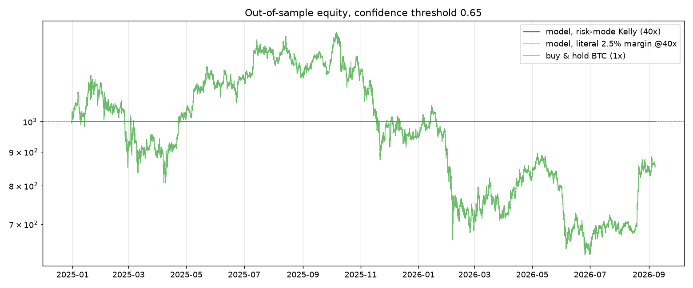

# BTC direction transformer: an honest null result

A small transformer that tries to predict whether BTC will be higher or lower 8 hours from now, a
walk-forward evaluation built so it cannot flatter itself, and a Kelly-sized Hyperliquid perp bot that
would trade the signal if there were one. There isn't: out of sample the model is a coin flip, the bot's
own rules refuse to trade it, and this repo shows the working.

**What it is.** PyTorch encoder (2 layers, d=64, about 110k parameters, 3-seed ensemble) over the last
24 hours of 30-minute bars: returns, realised vol, Hyperliquid funding, US spot-ETF flows, weekday and
NYSE-session clock. Output: P(up over the next 8 hours), temperature-calibrated. Around it: a fee-,
funding- and liquidation-aware backtest, fractional-Kelly position sizing at 40x isolated leverage, and
a live loop with kill switches.

**The walk-forward method.** Expanding window, quarterly test folds from 2025-01-01 to 2026-09-07
(7 folds, 29,491 bars). Every prediction is made by a model that never saw that quarter. Early
stopping uses the most recent 15% of each training window, with an 8-hour embargo so no label straddles
a split. ETF flows are only usable after their publication lag; features only use bars that had closed
at decision time (there are tests for both). A logistic regression on the last bar is fitted on
identical folds as the floor. No fold, threshold, feature or hyperparameter was tuned on the
out-of-sample quarters: what is in `reports/` is the first run, not a selected one.

**The result.** Out-of-sample AUC is **0.511** (accuracy 0.512, log-loss 0.6933 against 0.6931 for a
coin flip). The logistic baseline gets 0.513, so the transformer adds nothing over one bar of features.
Calibrated confidence never reaches the 0.65 trading threshold (the maximum is 0.618), so the
backtest places **0 trades** and ends on the $1,000 it started with. Forcing it to trade by lowering
the threshold loses money: at 0.55 it takes 52 trades, wins 34.6% against a 37.9% break-even, and ends
at $579. The 24-hour horizon is no better (AUC 0.498). Sections 6 and 9 have the full tables; the
useful output of the project is the evaluation harness and the refusal, not a strategy.



**Not investment advice.** Nothing here is a recommendation to trade. Live mode is **dry-run by
default** (`live.mode: dry_run` in `config.yaml`): it paper-trades and places no orders. Mainnet needs
a deliberate config change and your own API key in a git-ignored `.env`.

Also in the repo: a weekday x session descriptive study (`reports/sessions_summary.md`) and an
order-flow benchmark of eight sequence architectures on tick data (`orderflow/GUIDE.md`).

---

## 1. Setup

```bash
uv venv --python 3.12 .venv
uv pip install --python .venv/bin/python -r requirements.txt
.venv/bin/python -m btcbot fetch                 # candles + funding + ETF flows into data/
.venv/bin/python -m btcbot sessions              # weekday x session tables  -> reports/
.venv/bin/python -m btcbot train                 # walk-forward + final ensemble -> reports/, models/final/
.venv/bin/python -m btcbot backtest              # Kelly/40x simulation on the OOS predictions -> reports/
.venv/bin/python -m btcbot.results               # regenerate reports/RESULTS.md + README section 6 from the report files
.venv/bin/python -m btcbot predict               # what the model says right now (no orders)
.venv/bin/python -m btcbot bot                   # live loop, mode from config.yaml (dry_run by default)
.venv/bin/python -m pytest tests -q
```

Data sources (all public, no keys):

| What | Source | Notes |
|---|---|---|
| BTC 15m candles since Dec 2023 | Coinbase Exchange public API (`bitstamp` also supported) | Hyperliquid's candle endpoint only returns the most recent ~5000 bars, so it cannot supply training history. Live features use the same Coinbase feed so train and inference match. |
| Hourly perp funding | Hyperliquid `fundingHistory` | Full history since 2023. |
| Daily spot-ETF net flows (IBIT, FBTC, BITB, ARKB, BTCO, EZBC, BRRR, HODL, BTCW, MSBT, GBTC, BTC) | Farside Investors | Farside sits behind Cloudflare. The run reported here used a `data/etf_flows.csv` (681 trading days, 2024-01-11 to 2026-09-04) captured through a browser; it is not redistributed in this repo, so `fetch` has to rebuild it. The bot retries a `cloudscraper` refresh nightly and falls back to the CSV; if the CSV gets older than `live.max_flow_age_days` the bot stops opening trades until you refresh it (paste new rows into the CSV, or run `fetch`). |

`data/`, `logs/` and the large per-bar report files (`oos_predictions.csv`, `backtest_equity.csv`) are
not in the repo; `fetch`, `train` and `backtest` regenerate them. The small report files behind every
table below are in `reports/`, and the final ensemble weights (2.6 MB) are in `models/`.

Look-ahead rule for flows: a day's print is treated as known at **16:00 ET + 8h = midnight ET**, i.e.
usable from the next day's pre-open session. Funding is known at its own timestamp. Features are built
from bars that have *closed* at the decision time.

## 2. Layout

```
config.yaml              every knob, commented
config_h24.yaml          overrides for the 24h-horizon sensitivity run (--config config_h24.yaml)
btcbot/
  data/prices.py         Coinbase / Bitstamp / Hyperliquid candles, CSV cache with incremental update
  data/funding.py        Hyperliquid funding history
  data/etf_flows.py      Farside parser + CSV cache + publication-lag alignment
  features.py            32 features per 30m bar; labels = sign of 8h forward return
  sessions.py            weekday x session study (no model)
  model/transformer.py   pre-norm encoder, CLS token, 1 logit
  model/train.py         AdamW + one-cycle, early stopping, seed ensemble, temperature calibration
  model/walkforward.py   expanding-window quarterly folds with embargo; logistic baseline; final bundle
  kelly.py               Kelly fraction, Hyperliquid liquidation math, order plan
  backtest.py            bar-by-bar simulation with fees, funding, stop/TP/liquidation, MC + baselines
  results.py             renders reports/RESULTS.md and README section 6 from the report files
  live/hl_client.py      hyperliquid-python-sdk wrapper (isolated leverage, market entry, SL/TP triggers)
  live/bot.py            polling loop, state file, kill switches, dry-run paper tracking
deploy/com.btcbot.plist  launchd job template to keep the bot alive on a Mac (edit the paths first)
tests/                   Kelly math, look-ahead safety, fill logic
reports/                 sessions_*.csv/.md/.png, oos_predictions.csv, backtest_*.csv/.json, equity_curve.png
```

## 3. The model

* Input: a window of 48 bars x 32 features. Per bar: log returns over 30m/2h/8h/24h/72h, 24h and 168h
  realised vol, bar range and body, volume z-score, distance from 24h high/low, current and 24h-summed
  Hyperliquid funding, hour-of-day (sin/cos, ET), weekday one-hot, NYSE-open flag, and the latest
  *known* ETF prints: total, 5-day and 20-day sums, IBIT/FBTC/GBTC individually, share of funds with
  positive flow, and the age of the print.
* Architecture: linear projection -> learned positional embedding + CLS token -> 2 pre-norm transformer
  encoder layers (d=64, 4 heads, GELU, dropout 0.2) -> LayerNorm -> MLP -> one logit.
* Training: BCE with label smoothing, AdamW, one-cycle LR, gradient clipping, early stopping on the
  most recent 15% of the training window (with an 8h embargo so no label straddles the split).
* Confidence: three seeds are trained per fold and their logits averaged; temperature scaling is fitted
  on the validation slice but **floored at 1.0**, so calibration can lower confidence but never raise it.
  `confidence = max(P(up), 1 - P(up))`.
* Evaluation: expanding-window walk-forward, quarterly test folds from 2025-01-01 to today. Every
  prediction in `reports/oos_predictions.csv` was made by a model that never saw that quarter. A
  logistic regression on the last bar's features is fitted on identical folds as a floor.

## 4. Sizing: what "2.5% at 40x with Kelly" actually means

Kelly's fraction is about how much of your equity is **at risk**, not how much notional you hold.
Leverage only decides how much collateral you post for a given notional, and how close liquidation is.

Hyperliquid facts (from the live `meta` endpoint): BTC max leverage 40x below $150M notional,
maintenance margin = half the initial margin at max leverage = **1.25%**. An isolated 40x position is
therefore liquidated after a **~1.27% move against a long / ~1.23% against a short** (exact formula in
`kelly.py`). BTC moves that much inside an 8-hour window about a third of the time (see
`liq_if_long_40x` in the session tables), so a 40x position **must** carry a stop well inside that
distance. Default stop = 0.8%.

For a trade with confidence `p`, take-profit `tp`, stop `sl`, round-trip fee `f` and slippage `s`:

```
b        = (tp - f - s) / (sl + f + s)             # net payoff ratio     (default 1.64 : 1)
f_full   = p - (1 - p) / b                         # full Kelly           (p=0.65 -> 0.436)
risk     = min(kelly_multiplier * f_full, max_risk_per_trade)      # quarter-Kelly, capped at 2.5%
notional = risk * equity / (sl + f + s)            # $1000 -> ~$2,750 notional
margin   = notional / 40                           # ~$69 posted as isolated margin
```

Two sizing modes (`trading.sizing_mode`):

| mode | what 2.5% means | $1000 example, p = 0.70 | loss if stopped | loss if liquidated |
|---|---|---|---|---|
| `risk` (default) | at most 2.5% of equity is lost when the 0.8% stop hits | notional $2,747, margin $69 | $25 | $69 (only if price gaps through the stop) |
| `margin` | literally post 2.5% of equity as isolated margin at 40x | notional $1,000, margin $25 | $9 | $25 |

`risk` mode is the Kelly-consistent reading and is what the backtest headline uses; `margin` mode is
also simulated for comparison. Both are reported.

Guard rails in `plan_trade`: stop must be inside `stop_liq_buffer` x liquidation distance, margin never
exceeds `max_margin_fraction` of equity, notional never below Hyperliquid's $10 minimum.

## 5. Backtest fill model (deliberately pessimistic)

Entry at the decision bar's close with taker fee (0.045%) and 1bp slippage each way; on each later bar
liquidation is checked first, then the stop, then the take-profit (both in one bar => stop assumed);
stop and horizon exits are market orders; liquidation loses the entire isolated margin; hourly
Hyperliquid funding is charged for every hour boundary the position is open; one position at a time;
decisions only at the configured ET times (09:00 = 30 min pre-open, 10:00 = 30 min post-open).

Alongside the headline run the report includes: the literal margin-mode run, buy & hold, a
**random-direction baseline** (same timing and confidence, coin-flip direction, 200 seeds), a
**threshold sensitivity** sweep, a **calibration table** (does 65% confidence mean 65% accuracy?), a
weekday x decision-time breakdown, and a **bootstrap Monte Carlo** of the trade sequence (probability of
ending below $1000, probability of a >50% drawdown).

## 6. What the numbers say

### Main run: 8h horizon

_Generated 2026-09-08 from `reports/`. Horizon 8h, walk-forward OOS 2025-01-01 to 2026-09-07, 7 quarterly folds._

#### Walk-forward skill (every prediction made by a model that never saw that quarter)

| model | bars | accuracy | AUC | log-loss (coin flip = 0.6931) | Brier (coin flip = 0.25) | coverage at conf >= 0.65 | accuracy on covered |
|---|---|---|---|---|---|---|---|
| transformer ensemble | 29491 | 0.512 | 0.511 | 0.6933 | 0.2501 | 0.0% | n/a |
| logistic baseline (last bar) | 29491 | 0.514 | 0.513 | 0.6946 | 0.2507 | 0.9% | 0.641 |

Per fold (transformer acc / AUC, then logistic acc / AUC):

| fold | test quarter | train rows | TF acc | TF AUC | LR acc | LR AUC | temperature |
|---|---|---|---|---|---|---|---|
| 0 | 2025-01-01 to 2025-04-01 | 14496 | 0.501 | 0.507 | 0.512 | 0.521 | 1.00 |
| 1 | 2025-04-01 to 2025-07-01 | 18168 | 0.526 | 0.548 | 0.533 | 0.543 | 1.75 |
| 2 | 2025-07-01 to 2025-10-01 | 21880 | 0.531 | 0.518 | 0.510 | 0.504 | 1.00 |
| 3 | 2025-10-01 to 2026-01-01 | 25634 | 0.494 | 0.526 | 0.533 | 0.542 | 1.33 |
| 4 | 2026-01-01 to 2026-04-01 | 29388 | 0.477 | 0.505 | 0.504 | 0.498 | 1.70 |
| 5 | 2026-04-01 to 2026-07-01 | 33060 | 0.534 | 0.531 | 0.508 | 0.519 | 12.20 |
| 6 | 2026-07-01 to 2026-09-07 | 36772 | 0.524 | 0.498 | 0.490 | 0.476 | 2.99 |

#### Calibration: does the confidence mean anything?

| confidence bin | bars | share of bars | realised accuracy | mean signed forward return (bps) |
|---|---|---|---|---|
| [0.50,0.55) | 27611 | 93.6% | 0.511 | +0.5 |
| [0.55,0.60) | 1769 | 6.0% | 0.520 | +15.5 |
| [0.60,0.65) | 111 | 0.4% | 0.586 | +18.4 |

#### Skill at the bot's decision times only

| decision time (ET) | bars | AUC | median conf | 90th pct conf | max conf | n at >=0.55 | acc at >=0.55 | n at >=0.60 | acc at >=0.60 | n at >=0.65 |
|---|---|---|---|---|---|---|---|---|---|---|
| 09:00 | 614 | 0.478 | 0.512 | 0.544 | 0.605 | 37 | 0.459 | 1 | 0.000 | 0 |
| 10:00 | 614 | 0.485 | 0.512 | 0.544 | 0.604 | 35 | 0.514 | 2 | 0.500 | 0 |
| ALL | 29491 | 0.511 | 0.512 | 0.544 | 0.618 | 1880 | 0.523 | 111 | 0.586 | 0 |

#### Backtest with the configured rules (Kelly risk mode, 40x, 0.008 stop / 0.016 take-profit, $1000 start)

* trades: **0**, final equity **$1000.00** (+0.0%)
* literal margin mode: 0 trades, final $1000.00
* buy & hold over the same window: -15.7%
* random-direction baseline (same timing/confidence, 200 seeds): median final $1000.00; 100% of random runs did at least as well as the model

#### Threshold sensitivity (what happens if you lower the confidence bar)

| threshold | trades | win rate | final equity | max drawdown | daily Sharpe |
|---|---|---|---|---|---|
| 0.50 | 498 | 0.359 | $3.57 | -0.996 | -5.06 |
| 0.55 | 52 | 0.346 | $579.17 | -0.512 | -1.32 |
| 0.60 | 2 | 0.500 | $983.33 | -0.025 | -0.48 |
| 0.65 | 0 | n/a | $1000.00 | n/a | n/a |
| 0.70 | 0 | n/a | $1000.00 | n/a | n/a |
| 0.75 | 0 | n/a | $1000.00 | n/a | n/a |
| 0.80 | 0 | n/a | $1000.00 | n/a | n/a |

Break-even win rate for this stop/take-profit structure is 1/(1+b) with b = 1.64, i.e. **37.9%**. Any threshold whose win rate sits below that loses money regardless of leverage; leverage only sets how fast.


### Sensitivity run: 24h horizon

_Generated 2026-09-08 from `h24/`. Horizon 24h, walk-forward OOS 2025-01-01 to 2026-09-06, 7 quarterly folds._

#### Walk-forward skill (every prediction made by a model that never saw that quarter)

| model | bars | accuracy | AUC | log-loss (coin flip = 0.6931) | Brier (coin flip = 0.25) | coverage at conf >= 0.65 | accuracy on covered |
|---|---|---|---|---|---|---|---|
| transformer ensemble | 29459 | 0.523 | 0.498 | 0.6948 | 0.2508 | 0.0% | n/a |
| logistic baseline (last bar) | 29459 | 0.528 | 0.517 | 0.6951 | 0.2509 | 0.4% | 0.531 |

Per fold (transformer acc / AUC, then logistic acc / AUC):

| fold | test quarter | train rows | TF acc | TF AUC | LR acc | LR AUC | temperature |
|---|---|---|---|---|---|---|---|
| 0 | 2025-01-01 to 2025-04-01 | 14436 | 0.473 | 0.480 | 0.497 | 0.485 | 1.00 |
| 1 | 2025-04-01 to 2025-07-01 | 18108 | 0.540 | 0.557 | 0.590 | 0.596 | 12.20 |
| 2 | 2025-07-01 to 2025-10-01 | 21821 | 0.530 | 0.521 | 0.478 | 0.474 | 1.30 |
| 3 | 2025-10-01 to 2026-01-01 | 25575 | 0.531 | 0.552 | 0.551 | 0.561 | 1.00 |
| 4 | 2026-01-01 to 2026-04-01 | 29328 | 0.459 | 0.498 | 0.509 | 0.526 | 1.24 |
| 5 | 2026-04-01 to 2026-07-01 | 33000 | 0.575 | 0.561 | 0.546 | 0.562 | 12.20 |
| 6 | 2026-07-01 to 2026-09-07 | 36713 | 0.566 | 0.539 | 0.521 | 0.520 | 1.92 |

#### Calibration: does the confidence mean anything?

| confidence bin | bars | share of bars | realised accuracy | mean signed forward return (bps) |
|---|---|---|---|---|
| [0.50,0.55) | 26478 | 89.9% | 0.524 | +7.7 |
| [0.55,0.60) | 2954 | 10.0% | 0.517 | +6.3 |
| [0.60,0.65) | 27 | 0.1% | 0.185 | -140.0 |

#### Skill at the bot's decision times only

| decision time (ET) | bars | AUC | median conf | 90th pct conf | max conf | n at >=0.55 | acc at >=0.55 | n at >=0.60 | acc at >=0.60 | n at >=0.65 |
|---|---|---|---|---|---|---|---|---|---|---|
| 09:00 | 614 | 0.518 | 0.509 | 0.551 | 0.602 | 65 | 0.523 | 1 | 0.000 | 0 |
| 10:00 | 614 | 0.506 | 0.509 | 0.550 | 0.602 | 63 | 0.460 | 1 | 0.000 | 0 |
| ALL | 29459 | 0.498 | 0.509 | 0.550 | 0.603 | 2981 | 0.514 | 27 | 0.185 | 0 |

#### Backtest with the configured rules (Kelly risk mode, 40x, 0.008 stop / 0.016 take-profit, $1000 start)

* trades: **0**, final equity **$1000.00** (+0.0%)
* literal margin mode: 0 trades, final $1000.00
* buy & hold over the same window: -15.7%
* random-direction baseline (same timing/confidence, 200 seeds): median final $1000.00; 100% of random runs did at least as well as the model

#### Threshold sensitivity (what happens if you lower the confidence bar)

| threshold | trades | win rate | final equity | max drawdown | daily Sharpe |
|---|---|---|---|---|---|
| 0.50 | 564 | 0.358 | $3.60 | -0.997 | -4.33 |
| 0.55 | 95 | 0.368 | $316.28 | -0.761 | -1.80 |
| 0.60 | 2 | 0.000 | $867.36 | -0.133 | -0.77 |
| 0.65 | 0 | n/a | $1000.00 | n/a | n/a |
| 0.70 | 0 | n/a | $1000.00 | n/a | n/a |
| 0.75 | 0 | n/a | $1000.00 | n/a | n/a |
| 0.80 | 0 | n/a | $1000.00 | n/a | n/a |

Break-even win rate for this stop/take-profit structure is 1/(1+b) with b = 1.64, i.e. **37.9%**. Any threshold whose win rate sits below that loses money regardless of leverage; leverage only sets how fast.

## 7. Running it live

1. **Never use your main wallet key.** In the Hyperliquid app: Settings -> API -> create an API wallet.
   API wallets can trade but cannot withdraw. Copy `.env.example` to `.env` and fill in the API
   wallet's private key and your account address. `.env` is git-ignored and the key is never logged.
2. Fund the perp account with the $1000 (USDC on Arbitrum -> Hyperliquid deposit).
3. Dry-run first: `live.mode: dry_run` (default). `python -m btcbot bot` paper-trades with real prices
   and writes `logs/bot_state.json`, `logs/trades.csv`, `logs/bot.log`. Watch it for a week.
4. Testnet next: `live.mode: testnet` with testnet USDC from the faucet (app.hyperliquid-testnet.xyz).
   This exercises the real order path (leverage update, market entry, reduce-only SL/TP triggers,
   horizon close, cancel) without money.
5. Mainnet: `live.mode: mainnet`. Install the launchd job so it survives reboots:
   edit the paths in `deploy/com.btcbot.plist`, then
   `cp deploy/com.btcbot.plist ~/Library/LaunchAgents/ && launchctl load ~/Library/LaunchAgents/com.btcbot.plist`.

Kill switches (all in `config.yaml -> live`): `touch logs/PAUSE` stops new entries immediately;
`daily_loss_limit` pauses for the day after losing 10% of start-of-day equity; `max_consecutive_losses`
pauses 24h after 4 losses in a row; `max_flow_age_days` refuses to trade on stale ETF data.
Every step is logged; the state file makes restarts idempotent (an open position is re-adopted and
closed at its horizon; if the exchange shows it already closed, the fills are reconciled).

What the loop does every `poll_seconds`: refresh ETF flows once a night; if a position is open,
reconcile it (closed by SL/TP -> book it; horizon reached -> market close + cancel triggers); if flat
and a decision bar just closed, rebuild features from live data, score the ensemble, size with Kelly,
place market entry then SL and TP reduce-only trigger orders.

## 8. Things you can change without touching code

`confidence_threshold` (0.65), `decision_times_et` (add "09:30" for the open itself, or trade every
half hour), `horizon_bars`, `stop_loss_pct` / `take_profit_pct`, `kelly_multiplier`,
`max_risk_per_trade`, `leverage` (anything up to 40), `sizing_mode`, `seq_len`, model size, number of
ensemble seeds, walk-forward fold length. Retrain after changing anything under `features` or `model`.

## 9. Known limitations

* Training and inference prices are Coinbase spot; execution is the Hyperliquid perp. The basis is
  usually a few bps and is absorbed by the fee/slippage assumptions, but the 15m/30m bar timestamps must
  be aligned (they are: both are UTC bar starts).
* NYSE holidays are hard-coded through 2027 in `calendar_et.py`.
* The Farside scrape is best-effort. If it breaks, the CSV fallback keeps the bot honest by refusing to
  trade on old data rather than silently feeding stale flows.
* The live order path is written against `hyperliquid-python-sdk` and cannot be exercised without an
  account; run it on testnet before mainnet.
* No fold, threshold, feature or hyperparameter was tuned on the out-of-sample quarters. What you see
  in `reports/` is the first honest run, not a selected one.

## Licence

MIT, see [LICENSE](LICENSE).
